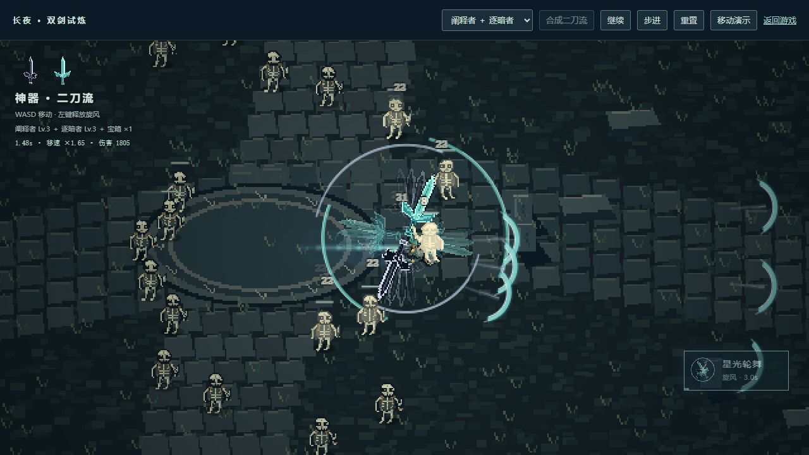
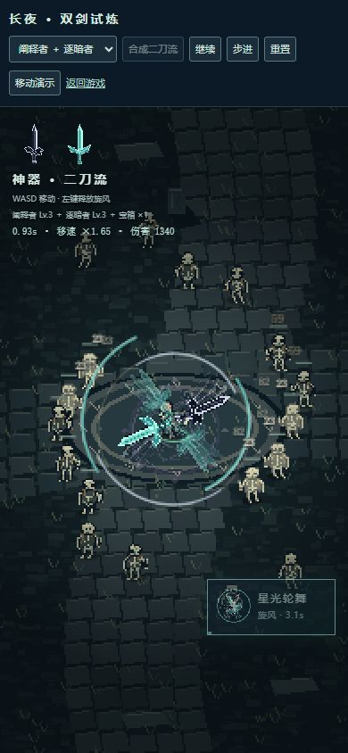

# 双剑与二刀流验证

日期：2026-10-16。结果：PASS。范围：`nightfall/` 主游戏。

## 环境与命令

- Windows，Node.js 24.10.0，Python 3.13 / Pillow 12。
- `npm run dev`，本地地址 `http://localhost:5173/`。
- `npm run build`：成功。构建器仍显示原有的路由静态分类提示，不阻断构建。
- `node --test tests/*.test.mjs`：266 / 266 通过。之后补充四人二刀流压力用例并验证断线取消，最终 `node --test tests/dual-swords.test.mjs`：9 / 9 通过。
- `node node_modules/typescript/bin/tsc --noEmit`：通过。
- `node node_modules/eslint/bin/eslint.js lib/dual-swords.mjs components/game/sword-skill.tsx`：通过。
- `git diff --check`：通过。

## 机制证据

| 前置状态与输入 | 结果 |
| --- | --- |
| 营地打开武器库，选择阐释者 | 初始武器切为阐释者；两把剑都进入普通获取与升级池 |
| 阐释者前方、后方、远处各放目标 | 仅近身前方目标受伤；同一次斩击不重复命中；目标过远不浪费挥剑冷却 |
| 逐暗者面对 240 / 370 距离目标 | 剑气实际飞行后依次命中与穿透 |
| 双剑 Lv.3，宝箱 ×1，合成 | 消耗一个宝箱次数和次武器位；近身斩击与三重剑气均增强；伤害归入二刀流 |
| 点击左键 / 技能按钮 | 旋风持续 3.5 秒、基础冷却 12 秒；角色和双剑旋转；移速 ×1.65；范围持续伤害与移动光轨均生效 |
| 长按、重复或冷却中提交相同 / 新请求 | 不重复释放，也不在冷却结束时自动补放 |
| 选牌暂停、死亡、断线、重新连接 | 暂停冻结计时；死亡 / 断线停止技能伤害与移速加成；重连不恢复已取消旋风 |
| 差分快照恢复并重发旧点击 | 主动持续时间、冷却和已消费序号保留；不生成第二个旋风；客机两个移动轴均预测加速 |
| 四人装备范围、冷却、数量与持续强化，连续模拟 15 秒 | 区域 ≤64，弹丸 ≤180，权威快照 <250000 字符；各玩家均有神器伤害 |
| 正常 / 减弱动态，桌面 / 手机画布 | Canvas 几何均有效；减弱动态保留攻击范围，关闭高速旋转与多层残影 |

## 浏览器实测

试玩页：`http://localhost:5173/tests/browser/dual-swords.html`。复用生产战斗模拟、绘制器与技能按钮，不给主游戏添加调试装备入口。

- 1280 ×720：实际点击合成、开启移动、左键释放；观察到旋风、双剑残影、移动光轨和持续跳字，状态从移速 ×1.00 变为 ×1.65。
- 390 ×844：实际点击技能按钮释放，持续时间和冷却提示可读，按钮在视口内，无横向溢出。
- 点击暂停与重置：画面可冻结检查，重置恢复基础双剑、未合成和未冷却状态。
- 开发期间测试页热更新曾出现重复创建 React root 的警告，已改为复用 root；最终重载后未新增此类错误。

## 范围限制

联机覆盖为输入清洗、差分传输、客机预测、快照接管和四人模拟测试；本次未进行真实跨设备或公网联机试玩。数值为初版设定，长期难度平衡仍需正常流程试玩。
