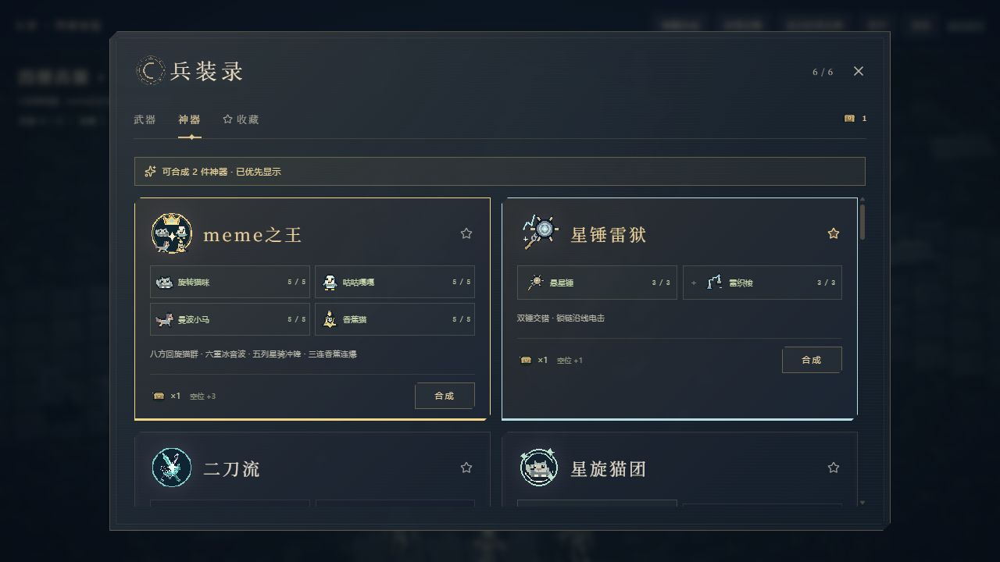
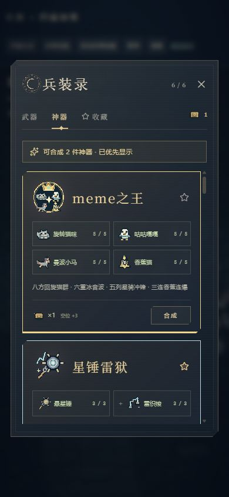
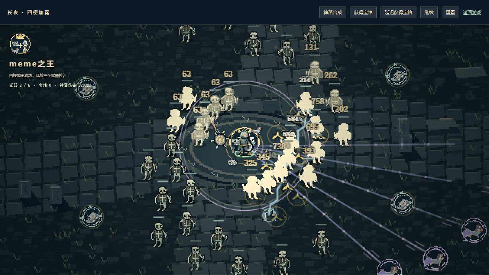

# 神器置顶与 meme之王验证

日期：2026-10-16。范围：`nightfall/` 主游戏。结果：PASS。

## 命令与结果

- `node --test tests/*.test.mjs`：275 / 275 通过，输出见 `regression.log`。
- `node --test tests/meme-king.test.mjs tests/meme-relics.test.mjs tests/arsenal.test.mjs`：22 / 22 通过，输出见 `targeted.log`。
- `npm run build`：成功，见 `build.log`；仍有构建器原有的路由静态分类提示。
- `node node_modules/typescript/bin/tsc --noEmit`：通过，见 `typecheck.log`。
- `node node_modules/eslint/bin/eslint.js lib/equipment.mjs lib/meme-arsenal.mjs`：通过，见 `lint.log`。
- `git diff --check`：通过。

## 合成 UI：真实浏览器验证

试玩页：`http://localhost:5173/tests/browser/meme-king.html`，复用生产的 ForgePanel、World 和 Renderer。

1. 初始装备六把武器，四把热梗武器均 Lv.5，宝箱为 0。打开面板后，meme之王无法合成。
2. 点击「延迟获得宝箱」，打开神器页，再点击列表底部「收藏星锤雷狱」，实际将配方列表滚至底部。读取到 `scrollTop = 2894`、首项二刀流、可合成数 0。
3. 宝箱到账后，读取到 `scrollTop = 0`、首项 meme之王、前两项分别为 meme之王和星锤雷狱，并显示「可合成 2 件神器 · 已优先显示」。因此材料达标时不需要手动向上或向下寻找。
4. 点击「合成meme之王」后，宝箱由 1 变为 0，武器由 6 / 6 变为 3 / 6，进入四种强化攻击的实战画面。
5. 在 390 ×844 竖屏重复获得宝箱、打开面板、点击合成。四项材料与等级完整显示；列表 `clientWidth = scrollWidth = 306`，无横向溢出。
6. 1280 ×720 与 390 ×844 均验证合成后的持续绘制、伤害增长、暂停和重置。浏览器未记录运行错误。

## 战斗和数据验证

- 四把材料分别低于 Lv.5、缺宝箱、材料已用于其他神器时，均无法合成。
- 合成消耗三件次武器并释放三个武器位，清理原四把武器的弹丸与区域，重复请求不会再次扣宝箱。
- 基础每轮为 8 只往返猫群、6 重冰音波、5 列骑兵和 3 枚香蕉炸弹；归属同一玩家和 meme之王伤害项。
- 冰音波扩大至基础半径 420，普通怪短暂冻结；骑兵产生伤害星轨；果皮爆炸半径扩大，每名玩家最多 12 片，支持连锁。
- 同一组 24 个静止目标、相同初始属性、12 秒确定性模拟中，神器伤害超过四把满级基础武器合计的两倍。该结果用于验证强化效果，不代表所有实战场景的伤害倍率。
- 范围、持续时间、复刻模具、攻速和冷却强化继续作用于合成攻击。
- 差分快照与房主恢复保留攻击前摇、回旋状态、合成材料占用和伤害归属。消除了极小浮点余量让冷却或骑兵前摇多等一帧的边界。
- 四名玩家同时使用强化后的神器连续模拟 20 秒，弹丸 ≤180、区域 ≤64、权威快照 <250000 字符；断线后所有攻击组件停止。
- 原四件单武器热梗神器、二刀流和其余武器回归通过。
- 图标追加到已有图集的空白单元，生成脚本断言此前所有其他单元像素不变。

## 范围限制

联机验证使用四人模拟、输入处理及真实序列化的差分快照恢复；本次未安排跨设备或公网联机。强度为初版数值，长期平衡仍需正常游戏流程试玩。
